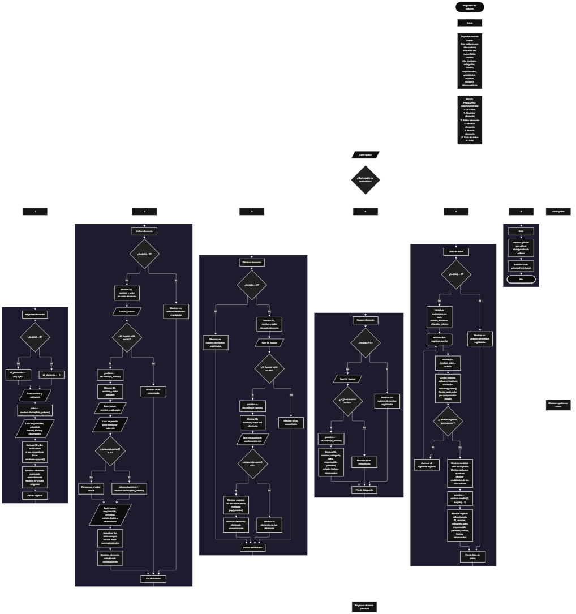

Este proyecto, llamado <b>asignador de colores</b>, fue desarrollado en <b>python</b> como un ejercicio práctico para fortalecer la lógica de programación mediante la creación de un sistema de gestión de elementos desde la consola. El programa cuenta con un menú principal de seis opciones que permite <b>registrar, editar, eliminar, buscar, listar y consultar información completa</b> de los elementos registrados. Cada elemento almacena datos como el nombre, la categoría, el color asignado, el responsable, la prioridad, el estado, la fecha de registro y las observaciones, utilizando nueve listas relacionadas para organizar la información durante la ejecución. El sistema dispone de una lista de diez colores y utiliza el módulo <b>random</b> para asignar colores aleatoriamente, permitir su reasignación durante la edición y seleccionar un registro al azar al consultar la lista de datos. Durante su desarrollo se aplicaron conceptos fundamentales de programación, como variables, listas, estructuras condicionales, ciclos repetitivos, estructuras de selección, contadores y operaciones para buscar, modificar y eliminar registros. Este proyecto permite poner en práctica los conocimientos adquiridos en Python y sirve como base para desarrollar sistemas de gestión más avanzados utilizando otros lenguajes y tecnologías.

<h2 align="center">⚙️ Funcionamiento del menú principal</h2>

### ➕ Registrar elemento

La opción <b>1) registrar elemento</b> permite incorporar un nuevo elemento al sistema. Antes de realizar el registro, el programa comprueba si la lista <b>ids</b> está vacía mediante la condición <b>len(ids) == 0</b>. Si no existen registros, asigna el identificador <b>1</b> a la variable <b>id_elemento</b>; de lo contrario, utiliza el último identificador almacenado más uno mediante la expresión <b>ids[-1] + 1</b>. Después, solicita el <b>nombre y la categoría</b> del elemento. A continuación, utiliza <b>random.choice(lista_colores)</b> para seleccionar aleatoriamente un color de la lista predefinida, que contiene diez opciones: rojo, azul, verde, amarillo, naranja, morado, blanco, negro, gris y celeste. Posteriormente, solicita el responsable, la prioridad, el estado, la fecha de registro y la observación. Los datos se almacenan en sus respectivas listas mediante el método <b>append()</b>. Finalmente, muestra el mensaje <b>"elemento registrado correctamente."</b>, el identificador generado y el color asignado. El código no establece una capacidad máxima de registros ni comprueba que el color seleccionado sea diferente de los colores de otros elementos.

### ✏️ Editar elemento

La opción <b>2) editar elemento</b> permite modificar la información de un elemento registrado. Primero, el programa comprueba si existen registros mediante la condición <b>len(ids) == 0</b>. Si no hay elementos, muestra el mensaje <b>"no existen elementos registrados."</b>. En caso contrario, presenta una lista con el identificador, el nombre y el color de cada elemento. Después, solicita el identificador que se desea editar y comprueba si se encuentra en la lista <b>ids</b>. Si existe, utiliza <b>ids.index(id_buscar)</b> para obtener la posición correspondiente y muestra el identificador, el nombre y el color actuales. A continuación, solicita el nuevo nombre y la nueva categoría, y pregunta si se desea reasignar el color automáticamente. Si la respuesta, convertida a mayúsculas mediante <b>upper()</b>, es igual a <b>"S"</b>, el programa selecciona un nuevo color utilizando <b>random.choice(lista_colores)</b>; en caso contrario, conserva el color existente. Después, solicita el nuevo responsable, la prioridad, el estado, la fecha y la observación, actualizando los valores de las listas correspondientes. Finalmente, muestra el mensaje <b>"elemento actualizado correctamente."</b>. Si el identificador no está registrado, presenta el mensaje <b>"id no encontrada."</b>. El identificador no se modifica durante esta operación.

### 🗑️ Eliminar elemento

La opción <b>3) eliminar elemento</b> permite eliminar un registro del sistema mediante su identificador. Antes de comenzar, el programa comprueba si existen elementos almacenados. Si la lista está vacía, muestra el mensaje <b>"no existen elementos registrados."</b>. Si existen registros, presenta una lista con el identificador, el nombre y el color de cada elemento. Después, solicita el identificador que se desea eliminar y verifica si se encuentra en <b>ids</b>. Cuando el elemento existe, utiliza <b>ids.index(id_buscar)</b> para localizar su posición y muestra su identificador, nombre y color. A continuación, solicita confirmación mediante la pregunta <b>"¿desea eliminar este elemento? (s/n):"</b>. Si la respuesta convertida a mayúsculas mediante <b>upper()</b> es igual a <b>"S"</b>, elimina la misma posición de las nueve listas utilizando <b>pop(posicion)</b>, manteniendo relacionados los datos de los registros restantes. Finalmente, muestra el mensaje <b>"elemento eliminado correctamente."</b>. Si la respuesta no es <b>"S"</b>, presenta el mensaje <b>"el elemento no fue eliminado."</b>. Si el identificador no existe, informa que el ID no fue encontrado.

### 🔎 Buscar elemento

La opción <b>4) buscar elemento</b> permite localizar un registro mediante su identificador y consultar toda su información. Primero, el programa comprueba si la lista <b>ids</b> está vacía mediante la condición <b>len(ids) == 0</b>. Si no existen registros, muestra el mensaje <b>"no existen elementos registrados."</b>. En caso contrario, solicita el identificador que se desea buscar y comprueba si se encuentra en la lista <b>ids</b>. Si existe, obtiene su posición mediante <b>ids.index(id_buscar)</b> y muestra el identificador, nombre, categoría, color, responsable, prioridad, estado, fecha de registro y observación. Si el identificador no se encuentra, presenta el mensaje <b>"id no encontrada."</b>. Esta operación permite consultar los datos completos de un elemento sin modificar la información almacenada.

### 📋 Lista de datos

La opción <b>5) lista de datos</b> permite visualizar los elementos registrados y consultar estadísticas generales sobre sus estados y colores. Primero, el programa comprueba si existen registros. Si la lista está vacía, muestra el mensaje <b>"no existen elementos registrados."</b>. Si hay elementos, inicializa los contadores <b>activos, inactivos, rojo, azul, verde, amarillo, naranja, morado, blanco, negro, gris y celeste</b> en cero. Después, utiliza un ciclo <b>for</b> para recorrer los registros y mostrar el identificador, el nombre, el color y el estado de cada elemento. Durante el recorrido, compara los estados mediante el método <b>lower()</b> para contar los elementos activos e inactivos sin distinguir entre mayúsculas y minúsculas. Asimismo, compara cada color con los diez nombres definidos en el programa e incrementa el contador correspondiente. Al finalizar, muestra la cantidad total de registros, las estadísticas de estados y la cantidad de elementos de cada color. Finalmente, utiliza <b>random.randint(0, len(ids) - 1)</b> para seleccionar aleatoriamente una posición válida y mostrar la información completa del registro seleccionado, incluyendo su identificador, nombre, categoría, color, responsable, prioridad, estado, fecha y observación. Esta operación permite consultar los registros y obtener un resumen estadístico sin modificar los datos almacenados.

### 🚪 Salir del menú principal

La opción <b>6) salir</b> permite finalizar la ejecución del programa. Cuando el usuario selecciona esta opción, el sistema muestra el mensaje <b>"gracias por utilizar el asignador de colores."</b> y ejecuta la instrucción <b>break</b>, que termina el ciclo principal <b>while True</b>. De esta manera, el programa deja de mostrar el menú y finaliza su ejecución. Si el usuario introduce una opción diferente de los números del <b>1 al 6</b>, el programa ejecuta el bloque <b>else</b> y muestra el mensaje <b>"opción no válida."</b>, permitiendo continuar con el ciclo del menú.

<h2 align="center">🧠 Temas aplicados en el proyecto</h2>

### 📦 Variables

En este proyecto se utilizan variables para almacenar los datos introducidos por el usuario, controlar las operaciones del menú, identificar los elementos que se desean editar, eliminar o buscar, generar identificadores, asignar colores y calcular estadísticas. También se utilizan variables temporales para almacenar posiciones dentro de las listas y respuestas que determinan si se reasigna un color o se confirma la eliminación de un registro. Cada variable cumple una función específica dentro de las operaciones del asignador de colores.

🔢 **Opcion:** Almacena la opción seleccionada por el usuario en el menú principal.

🆔 **Id_elemento:** Almacena el identificador generado para un nuevo elemento.

🔎 **Id_buscar:** Almacena el identificador introducido por el usuario para localizar un registro.

📍 **Posicion:** Representa la posición de un elemento dentro de las listas y permite acceder a sus datos.

🎨 **Color:** Almacena el color seleccionado aleatoriamente durante el registro.

📝 **Nombre, categoria, responsable, prioridad, estado, fecha y observacion:** Almacenan temporalmente los datos introducidos durante el registro.

🔄 **Respuesta:** Almacena la decisión del usuario para confirmar la eliminación o determinar si se reasigna un color.

📊 **Activos e inactivos:** Cuentan los registros cuyo estado corresponde a activo o inactivo.

🎨 **Rojo, azul, verde, amarillo, naranja, morado, blanco, negro, gris y celeste:** Son contadores que almacenan la cantidad de elementos asociados con cada color.

🔁 **I:** Funciona como contador en los ciclos <b>for</b> que recorren las listas para mostrar registros y calcular estadísticas.

### 🗃️ Listas

En este proyecto se utilizan nueve listas paralelas para almacenar la información de los elementos registrados. Todas mantienen el mismo orden, de modo que la posición de un dato en una lista corresponde a la misma posición en las demás. Por ejemplo, la información del elemento situado en la posición <b>0</b> se encuentra distribuida entre <b>ids[0], nombres[0], categorias[0], colores[0], responsables[0], prioridades[0], estados[0], fechas[0]</b> y <b>observaciones[0]</b>. Esta organización permite agregar, consultar, modificar y eliminar los registros manteniendo relacionados sus datos.

🆔 **Ids:** Almacena los identificadores numéricos de los elementos.

📝 **Nombres:** Almacena los nombres de los elementos registrados.

🗂️ **Categorias:** Almacena las categorías de los elementos.

🎨 **Colores:** Almacena los colores asignados aleatoriamente.

👤 **Responsables:** Almacena los responsables de los elementos.

⚡ **Prioridades:** Almacena las prioridades indicadas por el usuario.

📊 **Estados:** Almacena los estados de los elementos, que se solicitan como activos o inactivos.

📅 **Fechas:** Almacena las fechas de registro introducidas por el usuario.

📄 **Observaciones:** Almacena las observaciones asociadas a cada elemento.

### 🎨 Lista de colores

El programa utiliza la lista <b>lista_colores</b> para definir los diez colores disponibles durante la asignación automática. Los valores se almacenan como cadenas de texto y se seleccionan mediante la función <b>random.choice()</b>. Esta función permite elegir un color al registrar un elemento y, cuando el usuario lo solicita durante la edición, seleccionar otro color para el mismo registro. La lista contiene los colores <b>Rojo, Azul, Verde, Amarillo, Naranja, Morado, Blanco, Negro, Gris y Celeste</b>. La selección es aleatoria y no impide que varios elementos tengan el mismo color.

### 🔀 Estructuras condicionales

En este proyecto se utilizan las estructuras <b>if, elif y else</b> para controlar las opciones del menú y determinar qué operación debe ejecutarse. También permiten comprobar si existen registros antes de realizar una operación, verificar si un identificador está presente en la lista <b>ids</b>, decidir si se confirma una eliminación y determinar si se debe reasignar un color. Durante el cálculo de estadísticas, las condiciones comparan los estados de los elementos y los colores almacenados para incrementar los contadores correspondientes. Estas estructuras permiten que el programa responda según los datos registrados y las decisiones del usuario.

### 🔄 Estructuras repetitivas

En este proyecto se utilizan los ciclos <b>while</b> y <b>for</b>. El ciclo <b>while True</b> mantiene activo el menú principal y permite ejecutar varias operaciones hasta que el usuario selecciona la opción de salida, que termina el ciclo mediante <b>break</b>. Por otro lado, los ciclos <b>for</b> recorren las listas para mostrar los registros disponibles y calcular las estadísticas de estados y colores. Estos ciclos facilitan el procesamiento de los elementos sin necesidad de escribir instrucciones individuales para cada registro.

### 🎯 Estructura de selección del menú

El programa utiliza una cadena de condiciones <b>if, elif y else</b> para evaluar la variable <b>opcion</b> y ejecutar la operación correspondiente. Las opciones del menú están organizadas de la siguiente manera: <b>1) registrar elemento, 2) editar elemento, 3) eliminar elemento, 4) buscar elemento, 5) lista de datos y 6) salir</b>. Si el usuario introduce un valor diferente de las opciones disponibles, se ejecuta el bloque <b>else</b> y se muestra el mensaje <b>"opción no válida."</b>. Esta organización permite controlar el funcionamiento del sistema desde un único menú principal.

### 🔢 Generación de identificadores

El programa genera automáticamente un identificador para cada nuevo elemento. Si la lista <b>ids</b> está vacía, asigna el valor <b>1</b>. Si existen registros, utiliza el último identificador almacenado más uno mediante <b>ids[-1] + 1</b>. De esta forma, cada nuevo registro recibe un identificador basado en los datos que permanecen en la lista. Sin embargo, como el cálculo depende del último elemento y no del identificador máximo histórico, un identificador eliminado puede volver a utilizarse si se elimina el último registro y se registra uno nuevo.

### 🎲 Selección aleatoria

El módulo <b>random</b> se utiliza para realizar dos operaciones aleatorias dentro del sistema. La primera es la asignación de colores mediante <b>random.choice(lista_colores)</b>, que selecciona uno de los diez colores disponibles. Esta operación se ejecuta durante el registro y puede repetirse durante la edición cuando el usuario responde <b>"S"</b> a la pregunta sobre la reasignación del color. La segunda operación utiliza <b>random.randint(0, len(ids) - 1)</b> para seleccionar una posición aleatoria de los registros existentes durante la opción de lista de datos. La selección se realiza únicamente cuando existen elementos registrados, por lo que el rango corresponde a las posiciones válidas de la lista.

### 🗂️ Gestión de registros

La gestión de registros se realiza mediante las nueve listas paralelas y los métodos disponibles para manipularlas. El método <b>append()</b> incorpora nuevos datos al final de cada lista; <b>index()</b> permite encontrar la posición de un identificador; y <b>pop()</b> elimina el dato de una posición determinada. Durante la edición, el programa actualiza directamente los valores de las listas, mientras que durante la eliminación retira la misma posición de todas ellas. Estas operaciones permiten mantener organizada la información mientras el programa permanece en ejecución. Los datos se almacenan en la memoria del programa y el código no implementa persistencia en archivos o bases de datos.

<h2 align="center">¿Cómo se implementaron las operaciones crud en el proyecto?</h2>

Las operaciones <b>crud</b> se implementaron mediante las opciones del menú principal para administrar los elementos registrados. La operación <b>crear</b> corresponde a <b>registrar elemento</b>, donde se solicitan los datos y se asigna un color aleatorio; <b>leer</b> se realiza mediante las opciones <b>buscar elemento y lista de datos</b>, que permiten consultar registros individuales, visualizar los elementos y revisar las estadísticas; <b>actualizar</b> corresponde a <b>editar elemento</b>, donde se modifican los datos y se puede reasignar el color; y <b>eliminar</b> se realiza mediante la opción <b>eliminar elemento</b>, que solicita confirmación antes de retirar los datos de las listas. Estas operaciones utilizan variables, listas, condicionales y ciclos para gestionar la información almacenada temporalmente durante la ejecución del programa.

<h2 align="center">Diagrama de flujo del proyecto</h2>

<h2 align="center">🛡️ Validaciones del programa</h2>

### 📭 No existen elementos registrados

Esta comprobación se utiliza en las opciones de <b>editar, eliminar, buscar y lista de datos</b>. El programa verifica si la lista <b>ids</b> está vacía mediante la condición <b>len(ids) == 0</b>. Si no existen registros, muestra el mensaje <b>"no existen elementos registrados."</b> y evita continuar con la operación correspondiente. Esta comprobación permite informar al usuario cuando no hay datos disponibles para las operaciones que requieren registros existentes.

### ❌ Identificador no encontrado

Esta comprobación se utiliza durante las operaciones de <b>editar, eliminar y buscar elemento</b>. Después de solicitar el identificador, el programa comprueba si el valor introducido se encuentra en la lista <b>ids</b>. Si existe, obtiene su posición mediante <b>ids.index(id_buscar)</b> y continúa con la operación seleccionada. Si no existe, muestra el mensaje <b>"id no encontrada."</b>. De esta manera, el programa comprueba que el identificador corresponda a un registro almacenado antes de modificarlo, eliminarlo o mostrar su información.

### 🎨 Selección de colores

Durante el registro, el programa selecciona un color mediante <b>random.choice(lista_colores)</b>, utilizando exclusivamente los diez valores definidos en la lista de colores. Durante la edición, pregunta si el usuario desea reasignarlo y solo realiza una nueva selección cuando la respuesta convertida a mayúsculas es igual a <b>"S"</b>. Esta lógica restringe las asignaciones automáticas a los colores de la lista, pero no comprueba si un color ya está utilizado por otro elemento ni garantiza que el nuevo color sea diferente del anterior.

### 🗑️ Confirmación de eliminación

Esta comprobación se utiliza en la opción <b>eliminar elemento</b>. Después de mostrar el identificador, el nombre y el color del registro seleccionado, el programa solicita confirmación mediante una respuesta de tipo <b>s/n</b>. La condición <b>respuesta.upper() == "S"</b> permite aceptar tanto la letra <b>s</b> como la letra <b>S</b>. Si se cumple, elimina los datos de las nueve listas mediante <b>pop(posicion)</b>. En caso contrario, muestra el mensaje <b>"el elemento no fue eliminado."</b>, conservando el registro.

### 📊 Comprobación de estados y colores

Durante la opción <b>lista de datos</b>, el programa utiliza contadores para calcular la cantidad de elementos activos e inactivos, así como la cantidad correspondiente a cada uno de los diez colores. Los estados se comparan mediante <b>estados[i].lower()</b>, por lo que las diferencias entre mayúsculas y minúsculas no afectan al conteo. En cambio, los colores se comparan directamente con los nombres definidos en <b>lista_colores</b>. Si el estado introducido no coincide con <b>"activo"</b> o <b>"inactivo"</b>, no se incrementa ninguno de esos dos contadores. Del mismo modo, cada color se cuenta únicamente cuando coincide exactamente con uno de los valores esperados.

### 🎲 Selección de un registro aleatorio

Antes de seleccionar un registro aleatorio, el programa comprueba que existan elementos registrados. Cuando hay datos disponibles, utiliza <b>random.randint(0, len(ids) - 1)</b> para obtener una posición entre el primer y el último índice válido de las listas. A partir de esa posición, muestra la información completa del elemento seleccionado. La selección no modifica el registro ni filtra los resultados por estado, prioridad o color.

### ⚠️ Opción inválida

La estructura condicional del menú incluye un bloque <b>else</b> que se ejecuta cuando el valor introducido no coincide con ninguna de las seis opciones disponibles. En ese caso, el programa muestra el mensaje <b>"opción no válida."</b> y vuelve al menú principal gracias al ciclo <b>while True</b>. Esta comprobación controla las opciones del menú, pero no incluye un manejo de errores para entradas no numéricas en los identificadores solicitados mediante <b>int(input(...))</b>, por lo que introducir texto en lugar de un número puede interrumpir la ejecución.

<h2 align="center">🎯 Objetivo del proyecto</h2>

El objetivo principal de este proyecto es fortalecer la <b>lógica de programación</b> mediante el desarrollo de un sistema de asignación y gestión de colores en <b>python</b>. A través de su construcción se busca aplicar los conocimientos adquiridos sobre variables, listas, estructuras condicionales, ciclos repetitivos, generación de valores aleatorios y gestión de registros, integrándolos para resolver un problema de manera organizada. Además, el proyecto permite comprender cómo registrar, consultar, modificar y eliminar información, calcular estadísticas y utilizar selecciones aleatorias en una aplicación de consola. De esta manera, se establece una base para desarrollar sistemas de gestión más completos con otros lenguajes y tecnologías.

